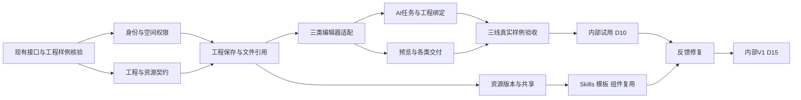

# 智创平台开发计划与排期｜开发执行版

版本：评审稿 V1，2026-11-17。首版仅内部使用，按 3 名全职开发估算；人员名单、技术接口和实际开工日待项目启动会锁定。本文仅制定计划，未实施产品修改。

## 1. 排期结论及适用条件

**D5 跑通交互页面样板，D10 开放三类创作核心试用，D15 交付内部 V1，D16～D25 完善约定增强范围。** 此为复用优先的冲刺方案，不代表已经证明能在 15 天完成当前原型的全部能力。

基准条件：A 为熟悉现有后端的全栈/集成开发，B 为统一前端与交互页面开发，C 为演示/影片全栈开发；每天按 1 个工作日投入，不把加班作为容量。现有代码、部署环境、账号/文件服务、三编辑器工程接口在 D1 可获取，D2 完成真实样例核验。产品负责人每天给出明确反馈，内部设计/策划参与阶段验收。

已有引擎继续承担编辑和运行；新增统一入口、项目索引、资源与任务连接。**一份工程在首版仍由原引擎保存，统一平台记录归属与访问方式。** 对本地原型已有、线上缺少的能力，移植业务逻辑并适配工程协议；不直接拿本地示例工程替换线上真实工程。允许页面跳转或嵌入接入，以能继续编辑、保存、返回为准，不以重写为统一标准。

估时包含 AI 辅助编码、基础测试、审查与交接。已有功能的估时主要用于接入、必要修补和验收；表内没有把所有可见功能重复按从零开发计算。未取得线上后端源码及接口文档，D2 后需按事实校准。

## 2. 首版范围与后续边界

| 能力域 | D10 核心试用 | D15 内部 V1 | D16～D25 约定增强 |
|---|---|---|---|
| 统一入口与项目 | 登录、空间归属、三类新建/继续编辑、列表筛选、保存重开 | 完善连续创作与产物追踪 | 成员界面、项目元信息、历史工程兼容样例 |
| 首页 Agent | 交互页面需求→资料→确认→工程；演示沿用现有生成链路；影片允许原节点流程 | 影片脚本生成及受限修改；生成素材进入工程 | 根据反馈完善策略与错误提示 |
| 交互页面 | 复用全部现有编辑功能；AI 首批只覆盖时间轴、卡片/案例墙 | 组件包上传、试编辑、两款适配组件和受限卡片生成 | 最多两项约定组件/同等工作量属性扩展 |
| 智能演示 | 大纲→页面→讲稿/配音→基础问答→预览及约定输出 | 句子标注、时间轴、热点、补充资料和问答范围 | 编辑细节与导出兼容性增强 |
| 互动影片 | 现有节点/分支/媒体/HTML跳转/发布同步；关键属性修补 | 脚本生成、补图/短视频、受限AI修改、指定终端适配 | 常用属性完善；已存在拍照换脸流程可条件纳入复用验收 |
| 素材与资源 | 上传、预览、选择、基本说明、使用权限；至少一个共享目录 | 个人/空间资源、版本副本、AI用途控制、模板/风格采用 | 收藏、资料包、依赖查询、配额及回收治理 |
| Skills | 内置约定说明供生成参考；不建设通用脚本执行器 | 上传、启停、自动匹配、来源版本及共享采用 | 用户投稿审核、方法沉淀 |
| 共创社区 | 不作为首条链路前置；可展示现有共享资源 | 管理员维护模板/素材/Skills/风格，成员浏览采用 | 作者投稿、管理员审核、驳回/撤回、发布版本 |
| 运行支撑 | 服务端身份与数据归属、异步任务、重试恢复、最小日志和内部部署 | 恢复补强、费用/失败查询、培训与验收 | 容量诊断、备份恢复深化、更多交付环境 |

**不是默认建设范围：**对外计费与客户租户、实时多人同屏编辑、完整企业知识库/向量检索、扫描件 OCR、任意 PPT 无损导入、任意 HTML 转原生对象、任意上传脚本执行、从零开发人脸融合算法。它们若确为业务刚需，需要单独估时。

文件解析首版优先验证 TXT/MD/DOCX/PPTX，CSV/JSON沿用已实现能力。智能演示截图有 PDF 上传声明，但本地解析未证明具备 PDF 正文能力；D1 收集首批真实资料，若文本 PDF 为必需，D2 对既有解析接口实测并将缺口升为 P0，置换等量低优先级工作或调整日期。扫描 PDF 不得当作普通文本 PDF 承诺。

语音问答的“配置已有”并不等于实际麦克风、识别、知识回答和续讲全部通过；C04 验证现有接口。若仅缺语音输入，保留文本问答作为明确受限的试用能力，并单列语音输入补齐日期；不可把文本问答计为语音功能完成。

## 3. 排期、人员与依赖

### 3.1 工作日与日期

以下仅按 2026-11-18 开工、周一至周五工作推算，不默认周末加班。

| 工作段 | 日期 | A 后端/集成 | B 前端/交互页面 | C 演示/影片 | 阶段结果 |
|---|---|---|---|---|---|
| D1～D2 | 11/18～11/19 | A01～A03，接口/身份核验 | B01、B02启动，交互样例及契约 | C01、C02启动，演示/影片样例 | 用真实样例锁定接入方案和首版范围 |
| D3～D5 | 11/20～11/24 | A04、A05，A06启动 | B02～B04，B05样板写入 | C02～C04及影片结构准备 | 交互样板可保存重开；其它线按契约接入 |
| D6～D8 | 11/25～11/27 | A06、A07，A08启动 | B05～B07，B08启动 | C05～C07，C08启动 | 三线连接真实数据和任务，进入联合测试 |
| D9～D10 | 11/30～12/1 | 部署、恢复/权限联调、问题修复 | 导出联调、流程收尾、业务验收 | 发布/问答/媒体联调、业务验收 | 核心试用通过后开放小范围用户 |
| D11～D13 | 12/2～12/4 | A10、A11、A14，A12启动 | B10～B12，B13启动 | C10～C12，C13启动 | 资源与生成增强进入共同环境 |
| D14～D15 | 12/7～12/8 | A12、A13及验收修复 | B13～B14及验收修复 | C13～C14及验收修复 | 内部 V1；发布说明、培训、未完成清单 |
| D16～D20 | 12/9～12/15 | 投稿审核、资源治理 | 社区、资料包与资源发现 | 编辑细节与影片体验 | 增强功能逐项验收，不等统一大合并 |
| D21～D25 | 12/16～12/22 | 诊断、恢复、可选既有换脸适配 | 组件增补、历史工程抽验 | 可选拍照流程、终端交付扩验 | 约定增强版；D25留联合验收和修复 |

表内窗口是可开展时段，不表示一个人同时做多个满日任务。接口未完成时可先按约定样例开发，依赖完成后必须在真实接口上复验；模拟接口通过不计最终通过。D5使用既有可访问测试环境，正式部署收尾在A08；若D1没有环境，立即计入阻塞。

### 3.2 容量校验

| 范围 | A | B | C | 专项联调/业务验收支持 | 缺陷机动 | 总容量 |
|---|---:|---:|---:|---:|---:|---:|
| D1～D10 | 8 | 8 | 8 | 3 | 3 | 30 人日 |
| D11～D15 | 4 | 4 | 4 | 1.5 | 1.5 | 15 人日 |
| D16～D25 | 8 | 8 | 8 | 3 | 3 | 30 人日 |
| 合计 | 20 | 20 | 20 | 7.5 | 7.5 | 75 人日 |

D1～D15每人安排12人日功能任务，剩3人日用于专项联调/验收和机动；D16～D25每人安排8人日功能任务，剩2人日。没有把一个人同时算入两条全职生产线。A 是公共后端瓶颈，C 同时负责两条编辑器，因此 C 的演示和影片任务按先后推进，不假设各有独立人员。

表中0.5/0.75等是工作量分配单位，不是精确到小时的承诺。前两天验证后给每项标记高/中/低置信度；不能复用的低置信度任务拆成独立缺口。只有满足前提才沿用36人日核心功能预算。

### 3.3 关键依赖

不要等公共服务全部写完才开始编辑器工作；D1确定样例契约后，界面和适配可独立推进。但权限、真实保存、工程绑定与运行必须按依赖完成。首条完整链路优先选交互页面，因为已有画布与导出基础最直接，能够尽早验证跨平台工程与素材协议。

## 4. 详细功能任务

任务共53项，其中P0 26项、P1 15项、P2 12项。负责人为角色占位，启动时替换为姓名；当前状态描述的是基础证据，不代表本轮接入已完成。CSV保留相同编号，方便导入项目管理工具。表内验收是建议的交付标准，不是已经完成的检查。

P0/P1按上述目标安排；P2在D15锁定具体反馈和可选专项。A23/C22仅在已有拍照换脸服务可用、内部首批业务需要时执行；若无需该场景，则4人日用于D15排在最前的缺陷/兼容项，并在清单中明确替换，不自动扩展新功能。

### P0：D1～D10 核心试用

#### A｜后端与集成

| ID／功能 | 现状及本轮交付 | 人日／窗口 | 依赖 | 验收标准 |
|---|---|---|---|---|
| A01 复用清单及后端样例 | **线上接口待核**；列出现有身份、项目、资产、生成、发布服务和责任人；取得真实工程样例 | 0.5／D1 | 无 | 三个系统各有负责人、工程样例和接口缺口记录 |
| A02 统一工程与任务契约 | **新增整合**；统一作品ID、空间ID、引擎类型、原工程ID、资源ID、任务ID和返回地址；不统一重写内部格式 | 0.5／D1 | A01；B01；C01 | 三方确认字段和最小保存/重开样例；变更有版本 |
| A03 账号及最小权限接入 | **复用待核**；复用现有登录；管理者、编辑者、查看者三类权限在服务端校验；内部账号由管理员配置 | 1／D2 | A01 | 两个账号/两个空间交叉访问被正确允许或拒绝；不能改前端角色绕过 |
| A04 云项目索引与工程保存 | **本地原型；线上待核**；接入项目列表、元信息、原引擎工程、保存状态和修订号；重命名/复制/软删除及恢复复用现有接口 | 1.5／D3–D4 | A02；A03 | 三类工程换浏览器能重开；过期修订号拒绝覆盖并提示另存 |
| A05 文件存储及素材引用 | **既有资产库可见**；复用上传、预览、下载和资源ID；归属与AI可用标记；引用文件不能随临时链接过期丢失 | 1／D4–D5 | A02；A03 | 上传图片/音视频/文档后另一账号按权限读取；工程中无临时blob引用 |
| A06 三编辑器服务适配 | **新增整合**；协调创建、加载、保存回调、预览/输出及来源返回；保留三个原引擎 | 1／D5–D6 | A02；A04；A05 | 三种类型有真实工程ID和保存回执；入口返回后能找到同一作品 |
| A07 AI任务服务化 | **本机服务已有实现**；复用模型接口和恢复逻辑；加入用户/空间归属、后台执行、状态查询、并发限制及任务去重 | 1.5／D6–D8 | A03；A05；A06 | 关页面再打开能续查；同一请求不重复提交付费任务；失败保留已完成结果 |
| A08 内部部署及最小运行记录 | **待接部署环境**；部署已有应用和适配服务；配置环境变量、备份、健康检查、调用错误及费用基础日志 | 1／D8–D9 | A03；A07 | 内部HTTPS可访问；有备份文件和一次恢复记录；日志与导出包不含密钥 |

#### B｜统一前端与交互页面

| ID／功能 | 现状及本轮交付 | 人日／窗口 | 依赖 | 验收标准 |
|---|---|---|---|---|
| B01 入口与前端适配核查 | **本地界面已有**；盘点路由、项目ID和交互工程字段；提交一个可编辑样例；确定首批样板 | 0.5／D1 | 无 | 与A02对齐创建、继续编辑和返回流程 |
| B02 统一首页与项目列表 | **本地原型已有**；接入账号/空间；三类新建、搜索筛选、最近项目、继续编辑、复制、删除恢复与保存状态 | 1／D2–D3 | A02；A03（先按契约开发） | 从首页/项目进入任一编辑器并正确返回；取消新建不丢原上下文 |
| B03 基础素材选择与上传界面 | **两端均有基础**；复用上传、分类预览和选择器；来源和AI可用说明；失效或无权资源提示 | 0.5／D3 | A02；A05完成后联调 | 三条线可选同一合法素材；失败可重试；无权资源不出现在候选中 |
| B04 交互页面工程适配 | **用户确认已有**；保留画布、分辨率、组件属性/外观/交互/命令；映射统一资源和项目；验证已有工程不丢内容 | 1.5／D1、D4–D5 | A02；A04；A05 | 一份时间轴和一份卡片/案例墙可保存重开；原交互有效；D5样板闭环 |
| B05 需求到可编辑交互作品 | **本地AI链路已有**；复用资料解析、内容确认、模板布局及图片绑定；首版限定时间轴和卡片/案例墙两类样板 | 1.5／D5–D6 | B04；A06；A07最终联调 | 真实资料生成字段进入现有编辑器；至少文字、图片及两种交互可手工修改 |
| B06 素材复用和缺图补齐 | **本地已有**；先选有权资源，缺图可手工补充或生成；保留原图；区分客户真实图与概念图 | 0.5／D6 | B03；B05；A07 | 人工选图不被覆盖；生成失败不丢正文；重复查询复用原任务 |
| B07 受限AI修改与撤销 | **本地已有**；当前作品/选中组件修改、确认应用、失败保留、撤销；先支持文案、图源、已开放样式参数 | 1／D7–D8 | B05；A07 | 修改指定对象不误改其它内容；刷新保留修改；可撤销一次已应用修改 |
| B08 交互预览与导出接入 | **用户确认已有**；复用浏览器ZIP、播放器离线ZIP/在线清单及资产包；核对现有管理平台接收协议 | 1／D8–D9 | B04；A06 | 浏览器包独立运行；约定管理平台测试环境可导入一份真实包，资源和命令有效 |
| B09 三类统一流程收尾 | **新增整合**；核对跨入口回退、命名、空态、失败提示；交互样例操作说明 | 0.5／D10 | B02–B08 | 项目列表显示真实保存结果；操作手册能指导非开发用户完成样例 |

#### C｜智能演示与互动影片

| ID／功能 | 现状及本轮交付 | 人日／窗口 | 依赖 | 验收标准 |
|---|---|---|---|---|
| C01 演示与影片复用核查 | **截图/线上配置可见**；取得两类样例与导出/发布方式；确认智讲中间工程、HTML事件协议及真实接口责任人 | 0.5／D1 | 无 | 各一份底层工程可保存重开；D2前列出无法复用环节 |
| C02 智能演示工程接入 | **现有演示/智讲基础**；接入新建、加载、保存、返回；保留PPT到智讲的已存在流转 | 1／D2–D3 | A02；A04完成后联调 | 演示与讲解使用关联工程ID；换浏览器后讲稿/素材仍在 |
| C03 资料、大纲、页面生产闭环 | **用户确认及截图**；资料解析→大纲编辑确认→生成→页面编辑；保留模板和单页重试；修正标题带入HTML注释的问题 | 1／D3–D4 | C02；A05；A07最终联调 | 8–15页真实样例可编辑；解析失败提示具体格式；标题为业务名称；失败页可单独重试 |
| C04 讲解与问答基础闭环 | **用户确认配置；本地有实现**；复用逐句讲稿、停顿/语速、配音与基础问答；按当前演示/页面资料回答；先沿用已有语音识别接口 | 1／D4–D5 | C03；A07最终联调 | 讲稿修改使相关旧配音失效；提问暂停并恢复讲解；资料外问题说明缺失；文字输入可兜底 |
| C05 互动影片工程及节点接入 | **用户确认；线上可见**；复用开始/剧情/选择/结局节点、连线、节点详情和素材绑定；统一项目归属与返回 | 1.5／D1、D5–D6 | A02；A04；A05；A06 | 两条分支分别到不同结局；保存重开保持节点/连线/素材不丢；不重建节点引擎 |
| C06 HTML跳转与剧情检查 | **用户确认skill适配；线上有事件**；将现有HTML适配要求形成固定输入检查和错误提示；核对事件到节点；检查断链/无结局 | 1／D6–D7 | C05 | 两份既有HTML导入后正确跳转；错误目标被提示；隔离内容不能越权调用平台 |
| C07 影片必需属性与媒体异常 | **大部分属性已可见**；逐字段验收位置/尺寸、文字、图片适配、音量/循环/结束跳转；仅补首批实际缺口；失败提示与重试 | 0.5／D7 | C05；C06 | 用户不写代码可完成约定样例；静音/循环/ended行为一致；缺媒体不出现无说明黑屏 |
| C08 演示输出与影片发布同步 | **已有基础；运行待核**；验收PPTX、演示在线播放/分享、影片链接及既有同步机制；不默认改变实时同步规则 | 1／D8–D9 | C04；C06；A06 | PPTX正文图片讲稿正确；在线讲解可运行；影片变更按记录规则生效；无权编辑被拒绝 |
| C09 三线样例与运行问题收尾 | **待验收**；演示/影片使用说明，修复跨流程关键问题，记录发布/播放边界 | 0.5／D10 | C02–C08 | 两条完整样例由业务人员复现；所有失败保留输入和工程 |

### P1：D11～D15 内部 V1 增强

#### A｜后端与集成

| ID／功能 | 现状及本轮交付 | 人日／窗口 | 依赖 | 验收标准 |
|---|---|---|---|---|
| A10 资源采用与固定版本 | **本地已有规则**；个人、空间共享、管理员共享目录；采用时固定资源版本；引用删除保护 | 1／D11 | A04；A05 | 源资源更新不误改旧作品；个人资源不会因采用而自动公开 |
| A11 Skills配置持久化 | **本地已有**；保存包、正文、启停、来源版本与空间；复用自动匹配，不执行任意脚本 | 0.5／D12 | A05；A10 | 跨浏览器保持启停及版本；无权技能不能进入模型上下文 |
| A12 生成产物与运行恢复补强 | **本地有恢复逻辑**；覆盖图片/配音/视频任务；复用已有任务表和媒体目录；加入恢复、上限和产物引用检查 | 1／D13–D14 | A07；A08 | 服务重启后可继续查询在途任务；取消/失败状态不冒充完成；产物链接持久可用 |
| A13 基础运行与费用查看 | **新增整合**；按任务查看耗时、失败、模型用量和费用记录；最小管理员查询界面/记录 | 0.5／D15 | A07；A12 | 能定位一次失败和一次重复请求；不承诺供应商未返回的精确费用 |
| A14 内部共享资源管理 | **本地社区已有**；管理员维护模板、素材、Skills、风格目录；版本号、上下架、采用记录；不含完整投稿审核 | 1／D12–D13 | A10；A11 | 管理员共享后成员可预览采用；下架不破坏已固定合法副本；来源可追溯 |

#### B｜统一前端与交互页面

| ID／功能 | 现状及本轮交付 | 人日／窗口 | 依赖 | 验收标准 |
|---|---|---|---|---|
| B10 资源目录与使用说明 | **本地已有**；素材说明、业务对象、标签、搜索、AI可用控制；展示个人/空间/共享范围 | 0.75／D11 | B03；A10 | 能找到约定资源；搜索/AI选择都执行相同权限与用途限制 |
| B11 Skills上传启停与采用 | **本地已有**；ZIP/文件夹上传、预览正文、启停、来源版本、自动匹配提示 | 0.75／D11–D12 | A11；B10 | 上传有效包可被匹配；停用不再使用；包异常给出原因；不执行包内脚本 |
| B12 HTML组件上传和试编辑 | **本地已有**；ZIP资源检查、隔离预览、参数试编辑、保存副本、下载和插入画布；复用两款已适配组件 | 1.25／D12–D13 | A10；B04 | 时间轴/悬浮卡片预览、试编辑、画布和导出结果一致；未公开参数明确不可编辑 |
| B13 模板和设计风格采用 | **本地已有**；从共享模板创建副本；选择风格或无；生成遵循样式与来源约束；首版管理员维护 | 0.75／D13–D14 | A14；B10；B05 | 更换风格作用范围明确；模板副本可编辑；修改副本不影响源模板 |
| B14 受限组件生成入库 | **本地已有**；复用成果卡片模型配置生成；预览/试编辑后入库和插入；超出支持范围明确提示 | 0.5／D14–D15 | B12；A07 | 一次真实生成得到可编辑参数包；支持范围之外不显示虚假完成 |

#### C｜智能演示与互动影片

| ID／功能 | 现状及本轮交付 | 人日／窗口 | 依赖 | 验收标准 |
|---|---|---|---|---|
| C10 讲解标注、动画与时间轴 | **截图及本地已有**；讲稿句关联元素、现有转场/入场、字幕、语速；区别真实音频与估算时长 | 1／D11 | C04 | 选定样例讲到对应内容时出现正确标注；页面修改后标注引用仍有效 |
| C11 问答范围与热点补强 | **本地已有**；当前页/整份演示、补充资料、推荐问题、热点详情/提问/跳页；语音输入复用核验 | 0.5／D12 | C04；A05 | 有依据问题命中实际内容；越界不编造；麦克风拒绝时可用文本提问 |
| C12 脚本到节点与受限AI修改 | **本地已有**；确认节点、分支、素材方案后写入现有影片；先支持已有节点文案/素材/目标调整 | 1／D12–D13 | C05；C06；A07 | 确认后的分支写入后可继续编辑；非法引用阻止保存；不支持的新增操作明确说明 |
| C13 影片补图及短视频生成 | **本地已有真实视频记录**；复用图/视频任务、素材预览和采用；短视频参考样例；失败继续原任务 | 0.75／D13–D14 | C12；A12 | 真实生成短片可解码播放并绑定；不会用样片假冒生成；旧素材保留 |
| C14 首批播放设备适配 | **线上发布已有；实机待核**；Windows Chrome/Edge、实际展厅触控屏、手机Safari/Chrome各选首批实际设备；媒体启动/旋转/缩放 | 0.75／D14–D15 | C08；C10；C13 | 设备矩阵逐项记录；首屏可主动点击启动媒体；不使用任意设备均可的绝对承诺 |

### P2：D16～D25 后续补齐

#### A｜后端与集成

| ID／功能 | 现状及本轮交付 | 人日／窗口 | 依赖 | 验收标准 |
|---|---|---|---|---|
| A20 投稿审核与权限记录 | **本地流程已有**；提交快照、待审/通过/驳回/撤回、理由与日志、发布共享版本 | 2／D16–D18 | A14 | 作者不可审批自己无权限的投稿；审核后版本可被采用，私有依赖不泄露 |
| A21 资源版本与清理治理 | **本地有部分规则**；版本列表、依赖查询、受控删除、存储配额、回收站保留规则；不自动批量清除旧工程 | 2／D18–D20 | A10；A20 | 可查询被哪些作品引用；恢复后引用有效；清理有明确规则与记录 |
| A22 诊断、备份与容量补强 | **基础运行已有**；内部用量统计、失败定位、任务保留、备份恢复演练、内部并发基准测试 | 2／D23–D24 | A12；A13 | 按确认的并发数完成压力与恢复报告；瓶颈及扩容阈值明确 |
| A23 已存在拍照换脸服务接入核验 | **线上配置可见；实效待核**；核对现有服务、任务归属、结果引用、失败取消和短期文件清理；只做复用适配 | 2／D21–D22 | C05；A07；D15专项决定 | 有真实授权样例及单人成功/失败/重试记录；接口不存在时转独立专项，不在此重建算法 |

#### B｜统一前端与交互页面

| ID／功能 | 现状及本轮交付 | 人日／窗口 | 依赖 | 验收标准 |
|---|---|---|---|---|
| B20 社区投稿与审核界面 | **本地原型已有**；模板/素材/Skills投稿、状态、驳回原因、撤回；管理员审核；风格仍由管理员维护 | 2／D16–D18 | A20；B10 | 提交和审核状态跨账号一致；发布后可采用；撤回不会误删原作品 |
| B21 资源发现与创作资料包 | **本地部分已有**；收藏、分类筛选、来源、提示词/参数/参考资料/技能版本记录；复用同款时创建新副本 | 2／D18–D20 | A21；B13 | 从成果查看制作依据并复用；不带出无权附件和他人私有资源 |
| B22 交互组件与常用属性增补 | **既有目录；具体差异待锁**；按试用反馈最多补2个已选组件或同等2人日属性项；保留图层/撤销/交互；不预设扩建全组件库 | 2／D21–D23 | B12；D15反馈清单 | 每个增补有独立样例，画布、属性面板、预览、运行包一致 |
| B23 项目管理和历史作品补齐 | **原型已有；线上待核**；成员操作界面、作品元信息/封面、回收站、更多旧工程抽验；不进行未经评估的全量迁移 | 2／D23–D24 | A21；B02 | 三类各增加历史样例；失败可回退到原工程；未支持格式明确列出 |

#### C｜智能演示与互动影片

| ID／功能 | 现状及本轮交付 | 人日／窗口 | 依赖 | 验收标准 |
|---|---|---|---|---|
| C20 演示编辑与导出细节 | **已有基础**；按实际缺陷完善文字样式、素材裁剪/替换、页面增删排序、讲稿/音频联动；扩展PPTX兼容样例 | 2／D16–D18 | C10；C11；D15反馈 | 复杂样例重新生成单页不丢其它页；导出受限媒体明确提示；不承诺无损还原任意PPT |
| C21 影片非技术编辑与运行增强 | **属性部分已有**；按反馈补文本排版、图片裁剪、按钮状态、事件可视化、音频混合；扩充异常与终端样例 | 2／D18–D20 | C07；C14；D15反馈 | 首批编导无需写代码完成约定剧情；分支、媒体完成事件、失败重试无死路 |
| C22 拍照换脸已有流程体验核验 | **截图有丰富配置**；复用相机/取景/重拍/确认/模板/结果节点；权限拒绝、超时、取消提示；首期仅单人固定模板 | 2／D23–D24 | C05；A23接口核验；D15专项决定 | 获授权样例拍照到结果节点可运行；不采集额外人像；多人玩法另排 |
| C23 交付规范与播放器扩展验证 | **现有交付基础**；扩展已选展厅终端与管理平台样例；记录在线更新机制、资产包/运行包/演示链接差异；培训 | 2／D21–D22 | B08；C08；C21 | 交付说明列明设备/网络/同步条件；指定管理平台和终端验收可复现 |

## 5. 交付验收

### 5.1 必须通过的真实业务样例

| 编号 | 场景 | 验收动作与结果 |
|---|---|---|
| U01 | 交互页面样板1 | 企业大事件资料→内容确认→时间轴→替换图片→配置详情交互→保存→换浏览器重开→浏览器包运行 |
| U02 | 交互页面样板2 | 卡片/案例墙模板→调整布局和命令→预览→资产/运行包→指定管理平台导入；核对资源、位置、交互 |
| U03 | 智能演示样板1 | DOCX/PPTX资料→修改大纲→生成8～15页→更改单页→编辑讲稿→配音→播放提问→继续讲解→PPTX输出 |
| U04 | 智能演示样板2 | 复用模板并补资料→热点/问答范围→资料外提问→页面修改后的配音失效处理→重开及分享播放；增强部分D15验收 |
| U05 | 互动影片样板1 | 至少8个节点、2条分支、2个结局→配置图/视频/HTML→各走一次→发布链接→修改后验证既有同步规则 |
| U06 | 互动影片样板2 | 含背景音乐、旁白、循环视频及结束跳转的样例→模拟媒体失败→重试→移动端点击启动→重开继续编辑 |
| U07 | 资源复用，D15 | 上传素材/Skill→启用与限制用途→生成作品→保存资料和来源→复制到另一作品；原资源更新不覆盖已固定版本 |
| U08 | 组件复用，D15 | 上传已适配ZIP→预览→试编辑→入库→插入画布→导出运行；对不支持的HTML参数显示准确边界 |

以上为建议最小样本规模，D1用现有真实业务样例替代虚构占位；不要求为验收重新生成所有付费媒体。真实模型链路每类选择最小必要样例，明确费用与调用范围；日常回归使用固定样例或模拟接口，但必须单独标记。

### 5.2 数据、权限与异常

- 两个账号、两个空间覆盖查看/编辑/管理权限，含直接请求和通过Agent访问资源；前端隐藏按钮不代替后端拒绝。
- 至少一次换浏览器重开和一次服务重启后的任务恢复；同请求不得重复创建付费任务。
- 文件解析失败、图片生成超时、配音失败、视频不可播放、网络断开，均提示原因并保留已完成作品，允许局部重试。
- 两人或两窗口编辑同一工程时，旧修订号不得静默覆盖新内容；首版可用乐观锁，不要求同屏实时协作。
- 工程素材引用不得依赖当前浏览器临时地址；源资源删除/下架和访问权限变更的处理要有明确结果。
- 互动影片按现有实时同步机制验收：修改保存后刷新链接还是当前会话即时更新、是否需重新发布、缓存多久，逐项记录。新增草稿/发布双版本是独立产品决定，未纳入最快路径。
- AI修改范围明确，无法执行时返回实际限制；不以预置结果假冒实时生成。PPTX只交付其实际支持的内容，语音问答和热点仍依赖在线播放器。

### 5.3 内部上线门槛

没有数据丢失、越权读取、无法保存、主链路中断、错误分支或重复付费等阻塞问题。三类各两份工程通过，约定设备有结果记录。非阻塞视觉问题可登记后上线，必须有责任人和日期。

新增/修改的核心业务逻辑先写针对行为的测试，单元、接口集成与关键E2E分别验证；目标为变更核心模块覆盖率至少80%，不宣称已有全仓覆盖率达到80%。代码生成后由另一名开发审查，不能只凭构建通过认定业务完成。既有测试记录仅作基础，不等于本轮已回归。

建议在D2确认内部规模基线：例如10名已开通用户、3个同时编辑会话、最多2个同时执行的付费生成任务；这些是拟议测试参数，尚非已有性能结论。供应商耗时单独记录，页面响应与生成排队分别衡量。实际需求超过基线时重新做容量检查。

## 6. D2决策与延期处理

| 检查项 | 原排期成立证据 | 不满足时的处理 |
|---|---|---|
| 三引擎代码与负责人 | 能定位保存/加载/发布入口，每类有可编辑工程样例 | 保留原引擎入口，相关自动写入不计完成；补技术负责人后重排 |
| 登录与文件服务 | 两账号实测及文件上传/读取成功，可接入现有测试环境 | 增加熟悉原平台的后端；若需从零建设，内部V1暂按D20～D25复评 |
| 工程可写可重开 | 每类至少一次真实保存并重开，素材引用有效 | 按类型拆缺口；可先交入口过渡版，但不能称三线AI生产闭环 |
| 模型与任务 | 部署环境最小真实调用成功，知道如何续查任务 | 保留手工制作；生成能力列阻塞；若需新服务接入，单独估时 |
| PPT→智讲／HTML跳转 | 可运行工程及协议样例 | 优先解决中间格式和事件协议，不扩建编辑属性 |
| 交付形式 | 每类一份输出可打开，管理平台测试入口可用 | 将输出适配列关键路径；不能用编辑器预览代替交付验收 |
| 首批文件和终端 | 已收集实际输入格式与设备 | 先锁限定范围；新增OCR、特殊浏览器/离线要求逐项影响排期 |

若D8仍有某条线不能真实保存重开，立即将人员集中到该条关键路径，顺延P1装饰性增强；不让D10靠截图演示过关。若D12发现公共服务缺口已经消耗全部机动，D15只交付已通过项，并给剩余项新的明确日期。任何降级都在汇报中列明“原目标、当前可用、缺口、负责人、下一日期”。

## 7. 增员方案与执行节奏

| 配置 | 建议目标 | 人员使用方式 |
|---|---|---|
| 约2名全职 | 内部V1约20～25工作日 | 缩减并行度，先交互页面，再演示和影片；按同范围计算，不压缩验收 |
| 3名全职，基准方案 | D10试用，D15内部V1 | A公共服务、B交互/资源、C演示/影片；优先保障A接口不阻塞 |
| 4名熟悉系统的开发 | 争取D8试用、D12内部V1 | 新增D独立承担影片接入或后端适配；交付样例、接口契约和联调窗口必须先齐备 |
| 3开发＋1测试/集成 | 维持D10/D15，提高交付把握 | 提前编制样例、权限/恢复/终端回归；减少开发被重复验收打断 |

4名开发的D12目标具有更低估时置信度：按48人日总容量减去36人日功能工作、约3人日交接协调，最多留下约9人日联合验收/机动，仍受接口关键路径约束。不是人数增加就按比例缩短全部任务。若增员较晚或不熟悉代码，优先用于验证和修复，不修改首版日期承诺。

执行建议：每天15分钟只同步阻塞、当天可验收成果和次日依赖；当天完成的模块当天合入共同测试环境。每人同时只推进一个主要工作包；由AI生成实现和测试草案，人负责工程契约、业务判断、代码审查和真实环境验证。D2、D5、D10、D15做短评审，以可运行样例和验收记录为准。

交付记录统一包含：任务ID、负责人、实际开始/完成日期、代码或部署版本、验收样例、是否真实接口、问题清单。每日不追求“已写多少代码”，而是核对能否完成用户制作流程。

## 8. 依据与使用方式

证据索引与已完成能力详见 [03_现状核查与证据.md](03_现状核查与证据.md)。可分配清单为 [04_功能任务排期.csv](04_功能任务排期.csv)，53项编号与本文一致。领导沟通使用 [01_领导汇报版.md](01_领导汇报版.md)。

本计划没有读取或收录API密钥，也没有修改在线项目、发布作品或执行付费生成。本地11/16验收记录仅用于判断复用基础；本次未重新执行产品测试，不将历史日志当作本次上线验收。
