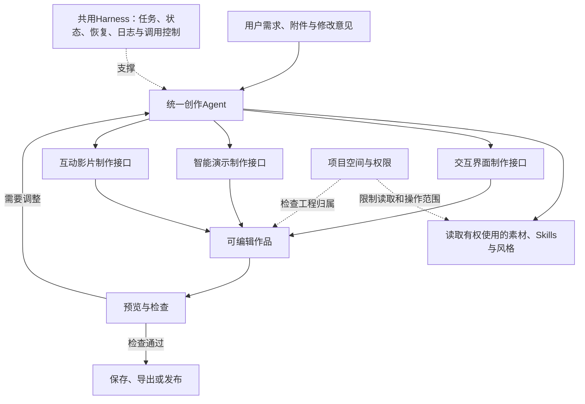

# 内容生产 Agent：开发内容与开源参考

2026年11月17日 · 技术路线讨论稿

## 1. 最终要做成什么

一个能理解制作需求、调用三个独立制作工具、使用所属项目资源、持续修改作品，并检查实际结果的创作助手。

例如：用户在某个项目空间上传企业资料，要求制作一份时间轴。Agent整理事件、寻找可用图片、选用合适的Skill、应用指定风格，把结果写入现有编辑器。用户说“只修改第三个事件”，它能修改对应内容，保留其它内容。中途关闭页面后可以继续，最后得到能编辑、保存和导出的作品。

**原型仅作为目标功能依据，不作为这些能力已经实现的证明。** 三个工具已有的手工制作功能，也需要分别接成Agent可调用的操作。

“开发人员用AI写平台代码”与“平台中的Agent替用户写新组件”是两项不同的能力。后者若属于最终目标，需要单独开发和验收。

## 2. Agent开发分成八部分

| 部分 | 具体开发内容 | 用户能看到的结果 | 开源框架可帮助什么 |
|---|---|---|---|
| ① 理解需求与规划 | 理解文字和附件；判断作品类型；补问缺失信息；整理结构、素材需求和制作步骤 | 不仅回应文字，还能给出准备执行的制作方案 | 模型连接、工具选择、步骤规划；制作规则仍需我们定义 |
| ② 调用制作工具 | 为三个工具接入创建、读取、修改、保存、预览和交付操作；把内容转换成各工具认可的工程格式 | 生成结果可以进入原编辑器继续修改 | 工具调用方式；三个编辑器的接入仍需开发 |
| ③ 管理制作过程 | 保存任务、步骤和中间结果；后台继续；局部重试；停止后续步骤；避免重复提交生成任务 | 断网、关页面或某一步失败，不必全部重做 | 任务状态、暂停恢复、错误处理；需连接实际存储和生成服务 |
| ④ 管理资料与上下文 | 记录空间、作品、选中对象、附件、版本和必要对话；按需读取资料；服务端检查权限 | “修改这个”有明确对象；不会串用另一项目的资料 | 历史管理、文件/记忆机制；项目归属和权限需我们实现 |
| ⑤ 使用素材、Skills和风格 | 搜索有权资源；选择并应用制作方法；将风格变成各工具支持的设置；记录采用版本 | 优先复用团队成果，并保持作品风格一致 | 检索和Skills加载机制；资源规则、实际执行与风格适配仍需开发 |
| ⑥ 持续修改与人工控制 | 在同一作品上多轮修改；限制修改范围；展示变化；应用、撤销；处理用户期间的人工改动 | 改一页不会重做整份作品，改按钮不会破坏其它组件 | 暂停、恢复与任务控制；编辑差异、撤销和冲突处理需我们实现 |
| ⑦ 检查结果并修复 | 检查工程、素材和跳转；实际运行预览；检查文字溢出和播放异常；有限次数修复 | 生成后能发现具体问题，修复或明确告知原因 | 接检查工具、循环修复；业务检查标准仍需我们建立 |
| ⑧ 运行记录与效果评估 | 记录调用、耗时、失败、重试和费用；固定案例反复测试；比较改版前后表现 | 出问题能追查；模型或提示词更新后不把原有能力改坏 | 调用追踪和评估基础；样例、指标和上线标准需我们定义 |

**Harness可以理解为让Agent稳定完成任务的运行系统。** 它重点负责进度、资料和状态、工具执行、恢复、控制和运行记录。八部分之间共用这些能力，不应每个工具各自再造一套。

其中，需求规划可以由模型灵活判断；权限检查、工程保存、版本检查和费用限制应由程序执行。不能只靠在提示词中写一句要求来保证。

## 3. 适合这个平台的基本结构

先用一个统一Agent协调三个制作工具，复杂任务再按需要分给内容策划、素材制作或组件开发等助手。三个工具不必各自再建一个独立聊天系统；多智能体数量也不应成为验收指标。

Agent应调用清晰的业务操作，例如“读取当前作品”“更新指定页面”“替换指定图片”“生成讲稿”“修改节点目标”“预览作品”。通过接口实现这些操作，比依赖Agent在后台模拟鼠标操作更适合作为主要接入方式。浏览器自动检查可用于验证产物。

### 需要先把住的四个技术前提

1. **编辑器必须允许程序创建和修改工程。** 能在页面里手工编辑，不代表Agent能调用。只把编辑器嵌入首页，不能算自动制作完成。
2. **空间、权限和作品版本要随每次操作传递并校验。** 在A空间发起的任务切换到B后仍属于A；长任务完成时若原作品已被人工修改，不能直接覆盖新版本。
3. **任务恢复需要记住外部生成任务。** 不能把“重试”等同于重新调用模型或重新生成视频；应先检查原任务是否已经成功。LangGraph也明确说明，框架重试不会自动保证外部操作只发生一次。[官方错误恢复说明](https://docs.langchain.com/oss/python/langgraph/fault-tolerance)
4. **生成后要有实际检查。** 保存接口成功不代表画面可用。规则检查负责结构、引用和跳转；浏览器检查负责能否打开、交互和播放；视觉检查用于辅助发现排版问题，最终审美判断仍由用户掌握。

## 4. 如果还需要Agent自己写组件，要增加什么

“选用现成时间轴组件”与“根据新需求编写一种从未有过的互动组件”应分别估时。后者需要增加一条代码制作流程：

**明确组件需求 → 生成代码和资源 → 在独立环境运行 → 打开预览并检查 → 修改错误 → 按平台组件格式打包 → 试编辑 → 入库和使用。**

| 增加部分 | 具体作用 |
|---|---|
| 独立运行环境 | 让每个任务在隔离环境中安装依赖、执行代码，不影响正式平台或其它项目 |
| 文件与依赖管理 | 保存源码、素材和依赖版本，后续能重开和修改 |
| 平台组件规范 | 规定如何暴露可编辑参数、接收设计风格、触发节点跳转及打包依赖 |
| 自动构建与浏览器检查 | 检查代码能否运行、页面是否报错、按钮是否有效、指定分辨率是否溢出 |
| 修复和停止规则 | 将错误反馈给Agent修复；超过次数或预算后停止并保留当前结果 |
| 组件交付与版本 | 通过检查后生成组件包，保存源码和可编辑参数；更新不破坏已使用版本 |

隔离环境通常称为sandbox。Deep Agents提供接入这类环境的方式，但仍需选择和配置实际运行环境。[官方sandbox说明](https://docs.langchain.com/oss/python/deepagents/sandboxes)

这项能力不能仅以“模型返回了一段HTML”验收；至少应得到可以运行、可以继续修改、可以被平台使用的组件包。

## 5. 可参考的开源项目

以下为截至2026-11-17查阅官方资料后的能力比较，适用性为针对本项目的判断。没有在我们的三个制作工具上进行框架实测，也没有认定某项目能直接交付整个平台。

| 项目 | 已提供的基础 | 在本项目中的用途 | 仍需我们完成 |
|---|---|---|---|
| **LangGraph** | 多步骤任务编排、保存状态、暂停与恢复、人工介入 | 作为可控制的任务运行基础，串起资料、生成、编辑和检查 | 三工具接入、实际任务存储、空间权限、编辑和交付规则 |
| **Deep Agents** | 基于LangGraph等组件，提供规划、文件上下文、子任务分工、记忆和Skills相关能力 | 在LangGraph基础上减少通用Harness建设，处理较复杂的制作任务 | 我们的工具、资源与风格适配；运行环境及业务验收 |
| **Mastra** | TypeScript Agent框架；工具、工作流、记忆、Harness及运行管理能力 | 团队主要使用TypeScript/Node.js时，作为另一条完整候选路线 | 三工具接入、业务权限和资源管理、检查与交付 |
| **OpenHands Software Agent SDK** | 面向代码任务，提供文件修改、命令运行、浏览器等工具 | 用于自主编写、运行和调试HTML/组件的专项能力 | 平台组件协议、编辑参数、风格和节点事件适配、产物验收 |
| **Dify** | 可视化工作流、Agent工具调用、知识处理和模型连接 | 快速验证资料整理、大纲生成等相对明确的流程 | 与编辑器深度连接、作品版本、持续修改及本平台的空间权限 |

能力依据：[LangGraph官方概览](https://docs.langchain.com/oss/python/langgraph/overview)、[Deep Agents官方概览](https://docs.langchain.com/oss/python/deepagents/overview)、[Mastra Harness](https://mastra.ai/docs/harness/overview)、[OpenHands SDK](https://docs.openhands.dev/sdk)、[Dify Agent节点](https://docs.dify.ai/en/cloud/use-dify/nodes/agent)。

源码入口：[LangGraph](https://github.com/langchain-ai/langgraph)、[Deep Agents](https://github.com/langchain-ai/deepagents)、[Mastra](https://github.com/mastra-ai/mastra)、[OpenHands](https://github.com/OpenHands/OpenHands)、[Dify](https://github.com/langgenius/dify)。

### 与选型直接有关的授权差异

- LangGraph、Deep Agents的对应开源代码使用MIT许可；它们的开源库与商业托管平台应分别考虑，不要求一开始采购托管服务。[LangGraph许可](https://github.com/langchain-ai/langgraph/blob/main/LICENSE)、[Deep Agents仓库](https://github.com/langchain-ai/deepagents)
- Mastra大部分代码采用Apache 2.0，但部分企业功能另有许可。官方列出的内置RBAC、细粒度权限和Agent Builder等生产功能涉及企业许可，不能把这些直接当成免费的项目空间权限系统。[Mastra许可说明](https://mastra.ai/docs/license)
- Dify采用附加条件的许可证，对多租户使用等有专门条款。我们的项目空间如何映射到Dify，需要在选型时明确，不能直接认定多空间方案没有授权限制。[Dify许可证](https://github.com/langgenius/dify/blob/main/LICENSE)

开源可以减少通用代码建设，模型调用、媒体生成、文件存储和运行环境仍需要实际资源。是否使用开源库、自建服务或商业托管，应分别估算。

## 6. 本项目的路线判断

**优先验证“LangGraph＋Deep Agents”这条路线；若开发团队以TypeScript为主且熟悉Mastra，再与Mastra做针对性比较。** 这是基于当前产品目标的架构判断，最终选择看真实接入结果和团队维护能力，不依据项目名气或演示效果。

LangGraph和Deep Agents分别提供任务运行基础和较完整的Agent Harness，并非要求把两套独立系统拼起来。使用Deep Agents时，可继续对关键业务步骤作明确控制。Mastra是另一条候选，不需要同时部署两套主运行框架。

自主组件开发确认为目标后，再考察是否在现有路线中加入代码执行能力，或接入OpenHands专项助手。不要一开始把所有框架叠加。Dify可用于快速验证局部流程，但是否承担整个创作Agent，应取决于持续编辑、工程版本和工具接入测试，而不是仅看能否生成大纲。

**开源复用重点：**模型连接、工具调用、步骤执行、暂停恢复、上下文管理、运行记录。

**平台必须开发的重点：**三工具工程接入、空间权限、素材和Skills使用规则、跨展项风格适配、指定范围修改与撤销、成品检查、社区审核与复用。Agent可以帮助准备投稿，但不能绕过管理员审核发布。

## 7. 最先验证的样例与开发次序

先以一个真实案例验证路线，避免只搭一个能聊天的演示：

> 在A项目上传企业大事件资料，生成指定风格的时间轴，使用现有图片、补齐缺图；进入现有编辑器继续修改。用户只更改一个事件，再关闭页面。重新打开后可以继续、撤销并导出。生成期间切到B项目，不出现A项目的资料和结果。

| 验证项 | 通过标准 |
|---|---|
| 实际工具调用 | 得到现有编辑器可打开的真实工程，能手工继续编辑 |
| 资料与资源使用 | 内容能对应上传资料；仅使用有权资源；说明用了哪些Skills和版本 |
| 风格应用 | 风格实际作用到时间轴、卡片和详情，不能只出现在提示词里 |
| 局部修改 | 只改变指定事件，保留其它内容和人工调整 |
| 任务恢复 | 中断后能继续查询/处理原任务，已完成内容不丢失，不盲目重复生成 |
| 空间隔离 | 切换到B后，A任务和结果仍归A；不能通过Agent读取无权资料 |
| 版本冲突 | 生成期间人工修改过作品，旧任务结果不会静默覆盖新内容 |
| 成品和成本 | 实际预览和导出可用；能查询调用、耗时、费用或用量、失败原因 |

开发顺序：**先做工具可调用、空间归属、工程保存和任务恢复；再打通一个制作案例；随后扩展另外两类、Skills和风格应用；持续修改与结果检查同步补齐；自主代码制作单独建设。**

这条验证路径用来确认技术方案可行，不代表缩减最终功能范围。三类工具接口、风格适配清单以及是否包含自主代码制作明确后，才能重新计算Agent部分的人日和整个平台排期。
