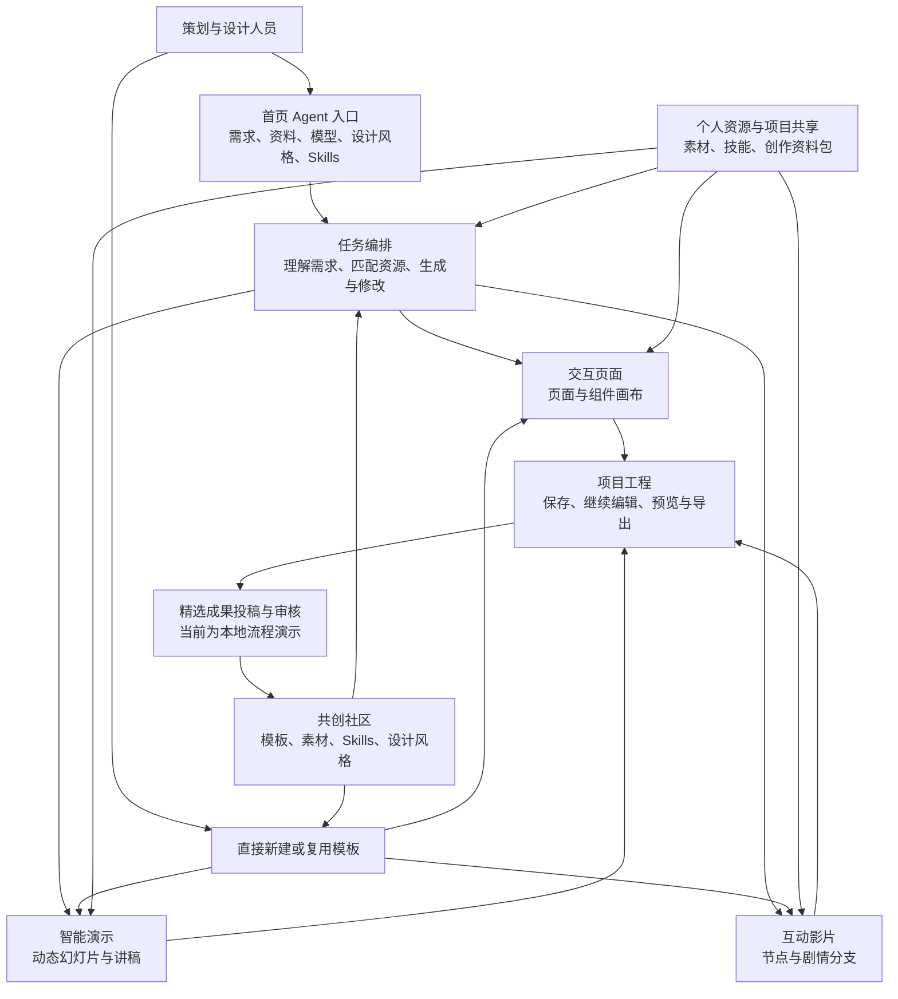

# 智创平台产品架构总结

基于当前 V1.6 原型与已确认产品定位，核查日期：2026 年 11 月 14 日。

## 1. 产品定位与核心目标

智创平台是面向内部策划、设计人员的内容智能生产平台，主要服务展厅内容制作，同时支持售前方案验证、产品汇报和开发指导。

**核心目标：提升内部内容生产效率，降低制作成本，持续沉淀可复用的知识与数字资产。**

产品架构可以概括为：**一个 Agent 入口、三类创作工作台、一套资源复用体系，由项目管理和智能服务共同支撑。**

以下是产品能力的逻辑划分，不代表已经部署为独立的后台服务或多个自主 Agent。

## 2. 总体架构

模型调用、任务状态、版本来源与空间权限是贯穿上述链路的支撑能力。生成的独立素材进入素材库，可编辑作品进入项目；优秀内容经审核后形成社区共享版本。

## 3. 五个产品层次

| 层次 | 核心模块 | 作用 |
|---|---|---|
| 创作入口 | 首页 Agent、新建项目、模板起步、最近草稿与继续任务 | 支持用自然语言提出需求，也允许直接进入工具创作 |
| 内容生产 | 交互页面、智能演示、互动影片 | 按不同内容载体组织制作、编辑和体验 |
| 资源与方法 | 素材库、组件、展项模板、Skills、设计风格、创作资料包 | 提供可用的资源、结构、制作方法与视觉规则 |
| 项目与共享管理 | 个人/项目空间、项目列表、搜索筛选、共享副本、投稿审核、回收站 | 管理作品归属、生命周期和资源复用关系 |
| 智能与运行支撑 | 内容策划、资源匹配、图片生成、受限内容修改、任务恢复、运行预览与导出 | 让生成结果可以进入作品、继续修改并用于演示 |

资源与方法层是横向支撑，不是必须依次经过的操作步骤。共创社区是共享内容的发现与分发入口，不单独承担编辑器功能。

## 4. 三类创作工作台

| 项目类型 | 内容组织方式 | 主要能力 | 典型用途 |
|---|---|---|---|
| **交互页面** | 页面、组件及组件间交互 | 空白/模板创建；自由编排；属性、布局、交互、动效与命令配置；素材替换；AI 修改；运行预览 | 企业历程、荣誉资质、案例墙、产业地图、关系图谱、数据看板 |
| **智能演示** | 幻灯片、讲稿与讲解顺序 | 主题与资料输入；大纲生成；页面及讲稿编辑；动态播放、讲解与提问体验 | 企业介绍、参观讲解、主题汇报、培训内容 |
| **互动影片** | 故事节点、选择与剧情分支 | 空白节点画布；流程/脚本生成节点草稿；图片、视频、HTML 绑定；连线、条件与分支预览 | 角色体验、分支叙事、情境探索、互动科普 |

这三类按主要内容载体和创作方式区分，并不意味着彼此不能包含交互、视频或问答。

当前原型在“智能演示”下仍保留历史的视频分镜工程及入口，供已有作品继续编辑；这属于现有实现兼容，不构成第四个顶层项目类型。智能演示的产品定位以动态幻灯片、自主讲解和智能问答为核心。

## 5. 资源体系：作品、素材、方法和规则

| 对象 | 保存什么 | 使用方式 |
|---|---|---|
| 项目工程 | 页面、节点、内容、交互与素材引用等完整创作状态 | 继续编辑、复制、预览、导出或投稿 |
| 展项模板 | 可复用的作品版本和结构 | 创建独立项目副本，替换内容后继续制作 |
| 素材 | 图片、视频、音频、组件及文档资料 | 上传、生成、选用、替换或共享；HTML 以嵌入组件使用 |
| Skills | 制作说明、输入要求、步骤、示例与关联文件 | 选择或上传 ZIP，作为创作方法与参考上下文采用 |
| 设计风格 | 配色、字体、排版、组件风格和动效原则 | 预览并应用；由平台侧维护，可选择“无” |
| 创作资料包 | 提示词、参数、参考文件、关联技能与来源 | 保留制作依据，支持参考同款效果继续创作 |

**知识沉淀目前主要体现为制作说明、素材业务信息、提示词和创作资料包，尚未形成独立的企业知识库与向量检索系统。**

资源有三种主要使用范围：

- **个人资源**：自己的素材与 Skills，跨业务项目空间持续可用。
- **项目共享资源**：围绕某个业务项目共同使用的资源，以及项目采用的固定副本。
- **共创社区资源**：经审核共享的模板、素材和 Skills，以及平台维护的设计风格。内置示例另有来源标识。

采用资源时记录来源和版本。个人或社区源后续变化，不应自动改写已有作品；个人资源也不会因为被项目采用而自动公开。

## 6. 项目管理与界面入口

当前左侧主要导航为：**首页、项目、素材库、Skills、共创社区**。

- **首页**：Agent 对话、文件与语音输入、模型选择、设计风格与 Skills 快捷选择、提示词和推荐模板。
- **项目**：管理三类可编辑作品，搜索、筛选、继续编辑、复制、投稿、删除与恢复。
- **素材库**：管理独立资源，补充素材说明及适用对象，控制是否允许 AI 调用，并支持画布选材。
- **Skills**：管理自己上传或从社区采用的技能，预览、使用和投稿。
- **共创社区**：模板、素材、Skills、设计风格四个板块，支持发现、预览、收藏与采用。

“新建项目”是动作入口；“最近草稿”和“继续创作任务”用于恢复工作；审核管理通过账号菜单进入。原 AI 演示中心、造梦机能力已分别归入智能演示和互动影片，不再作为平级侧栏入口。

需要区分：**“信泰企业展厅”等项目空间是业务协作容器；其中的一份交互页面、智能演示或互动影片，是一份作品工程。**

项目分类包含三个独立维度：项目类型决定编辑工作台，展示内容描述“讲什么”，展示形式描述“怎么呈现”。交互页面新建时后两项均可为“无”，投稿时至少补充一项。

## 7. 核心生产链路

**提出需求 → 组织内容 → 复用已有资源 → 补充缺失素材 → 生成初稿 → 人工与 AI 持续修改 → 预览与保存/导出 → 精选投稿 → 后续项目复用。**

Agent 是自然语言创作入口；三类工作台承担具体编辑；素材、模板、Skills 和设计风格为两者提供资源与规则。用户可随时从任务转入手动编辑，也可从已有作品继续使用 AI 修改。

未来希望逐步由 Agent 承担更多任务规划、工具选择与检查，让人更集中于提出需求、表达创意和确认结果。当前已经具备部分模型调用和受控编排，尚不是能够自主调用任意工具的通用多智能体系统。

## 8. 当前实现与后续完善的边界

| 能力 | 当前状态 |
|---|---|
| 页面/节点编辑、资源选用、作品保存、社区复用 | 已有可操作的原型实现，主要使用本机持久化 |
| 内容策划、草稿生成、受限 AI 修改与图片生成 | 已有 DeepSeek、万相接入代码与任务链路；服务实时可用性取决于配置与供应商，本次总结未调用接口验证 |
| 智能演示播放与问答 | 可体验页面播放、字幕、暂停提问和继续讲解；声音使用预置示例音轨，回答由当前讲稿形成演示内容，真实 TTS 与知识问答仍需完善 |
| Skills 执行 | 可导入、预览、采用说明与资料；包内脚本不会自动执行 |
| 新组件生成 | 已适配组件可生成配置并继续编辑；未知组件代码仍需开发适配 |
| 多人共创与审核 | 已展示空间、共享、成员及审核流程；真实多人同步、服务端鉴权和后台治理尚待建设 |
| 文件理解与检索 | 部分文档格式可提取有限文字，素材按说明与标签匹配；未实现完整多模态理解和向量检索 |
| 交付输出 | 交互页面可导出浏览器运行包；专业播放器仍需协议适配。未完成真实视频渲染与 PPTX 输出 |

## 9. 汇报时的一句话架构描述

**智创平台以 Agent 为创作入口，以交互页面、智能演示和互动影片为三类生产工作台，以素材、模板、Skills 和设计风格为复用基础，通过项目管理与共创社区连接内容生产和经验沉淀。**

核查依据：当前 `src/App.tsx`、`src/features/AppShell.tsx`、`src/domain/project-taxonomy.ts`、`src/domain/types.ts`、`src/domain/ai-run.ts`、`src/features/studios/PresentationViewer.tsx`，以及 `docs/使用与开发说明.md`、`server/README.md`。本次仅总结产品架构，未修改原型代码。
