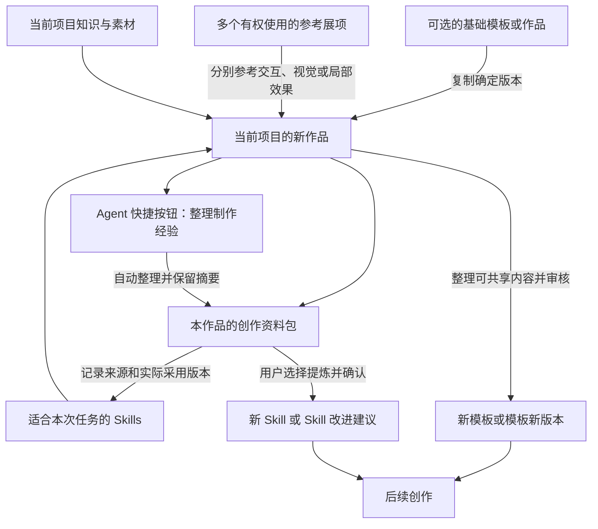

# 模板、创作资料包与 Skills：关联方式、多方参考与经验整理流程

2026 年 11 月 17 日 · 产品方案讨论稿

本文承接已认可的方向：复用优秀展项时，同时借鉴视觉交互、内容组织方法和设计经验，并结合当前项目知识重新创作。本轮根据讨论更新方案：保留素材卡片内现有的创作资料入口，将经验整理集中到 Agent，并补充多方参考。本次仅更新讨论文档，不修改原型功能或既有开发计划；方案描述不代表相关功能已实现。

## 1. 建议采用的总体关系

**以完整作品为中心，以创作资料包连接制作依据，以模板复用成果，以 Skills 复用方法。**

用户围绕完整展项进行制作、预览和修改，不增加“先确认代表页，再扩展整套”的默认环节。只有某个交互或技术效果存在不确定性时，才按需单独验证。

| 对象 | 回答的问题 | 主要保存内容 | 用户怎样接触 |
|---|---|---|---|
| 作品 | 这次为当前项目做了什么？ | 可编辑工程、实际内容、交互、当前版本 | 项目列表和三类工作台 |
| 模板 | 有什么成熟成果可以作为起点？ | 经过整理的完整工程版本、示例内容、可替换内容说明、适用条件 | 共创社区中的展项模板 |
| 创作资料包 | 这份成果依据什么、如何做成、为什么这样做？ | 需求摘要、多方参考、采用的资源及版本、已确认设计决定、适用限制与验证记录 | 保留素材卡片打开后的“创作资料”；制作过程中的整理和修改在 Agent 对话中完成 |
| Skill | 遇到同类问题，下次可以采用什么方法？ | 适用条件、输入要求、制作步骤、判断规则、检查要求和示例 | Skills 管理；Agent 按任务采用 |

创作资料包保持为作品或素材的附属记录。**不在项目卡片、作品工作台顶部和模板详情新增“创作资料”入口，也不新设侧栏管理中心。** 用户通过 Agent 整理当前成果；成果关联到素材时，从该素材已有的创作资料入口查阅对应记录。完整作品仍保存在项目中，不为展示资料包而额外复制成素材卡片。Skills 可以独立存在；没有 Skill 的作品，也可以成为可复用模板。

图中“记录版本”不表示源资源更新后自动更新作品。用户点击 Agent 快捷按钮后自动整理，不在每次生成或保存后强制弹窗；整理摘要不等于自动发布 Skill。

## 2. 当前产品可以承接什么，缺少什么

以下“已有”均指当前原型中可观察到的界面或代码行为，不代表正式平台已完成开发或已验证多人生产使用。沿用最新《功能模块与开发顺序》讨论稿的口径，独立制作工具能力、平台待接入能力和本地原型需分别说明。

| 现有基础 | 当前边界 | 本方案要补齐的关系 |
|---|---|---|
| 社区模板支持预览结构、查看复用说明、创建独立副本 | 复用说明主要介绍如何编辑，缺少具体展项的制作依据和适用判断 | 在现有复用说明中补充适用条件，由 Agent 带入可用方法和参考范围，不增加资料页签 |
| 作品数据可以携带创作资料包；素材详情可展示资料包 | 展示以提示词、文件、参数、技能为主，尚未形成 Agent 自动整理经验的流程 | 保留素材卡片的资料入口，扩充记录内容并增加 Agent 整理能力 |
| 素材“一键同款”会创建带参考资料的新草稿 | 与模板“直接复制并编辑”是两条分开的路径 | 在完整作品层面区分“复制后修改”和“结合新需求改编” |
| 当前参考草稿可携带一份创作资料包 | 尚未表达多个展项分别用于交互、视觉和局部效果的完整关系 | 增加多来源参考及范围记录，区分参考候选与实际采用 |
| Skills 支持上传、启停、按任务匹配和社区采用 | 当前匹配主要依赖关键词；说明进入模型上下文，不等于包内程序自动运行 | 将模板关联方法纳入候选，并说明本次实际采用情况 |
| 已有作品保存时固定 Skill 快照、资源采用记录和投稿快照 | 这些机制尚不足以构成统一的模板来源链和经验提炼流程 | 明确作品、模板、资料包和 Skill 各自的版本及关联 |
| 项目空间可配置 ACP 知识本地场 | 当前为本地绑定与归属记录，未接通检索和入库 | 正式接入后引用当前项目知识；接入前使用明确上传的资料 |

核心变化是把这些已有入口和对象连起来，尤其补齐“这次为什么这样做”以及“哪些做法值得下次复用”。

## 3. 三者具体怎样关联

### 3.1 模板关联一份经过整理的创作资料包

一个已发布模板版本，对应一份确定的工程快照和一份与该快照匹配的资料包。模板复用时，固定采用这个版本，并为新作品建立自己的资料包。

新资料包分别记录“继承的参考”和“本次实际采用的内容”。例如，源模板曾用过三个 Skills，本次只用其中一个，不能把另外两个记成已使用。

模板与资料包的关联是内部记录关系，不要求新增面向用户的资料入口。新作品可以有一个直接复制的基础工程，同时关联多个参考来源；也可以不复制任何工程，直接结合多个参考重新创作。

模板更新不改写已经创建的作品。作品可以查看新的模板版本，但应用更新应明确选择范围，并保留当前版本。

模板里的示例内容也应说明用途。客户专属内容可保留在有权限的项目内；准备跨项目共享时，应替换为有权共享的示例或清晰占位，并验证替换后的完整展项仍可运行。

### 3.2 资料包关联零个或多个 Skill 的确定版本

每项关联至少表达四件事：采用哪个版本、用于哪个制作环节、为什么采用、是否在本次真正应用。

建议在用户界面使用三个清晰状态：

- **原作采用**：说明来源作品怎么做成，是历史记录。
- **本次建议**：Agent 判断可能有帮助，尚未采用。
- **本次采用**：已经用于本作品，并记录具体用途。

原作采用的 Skill 可以帮助推荐，但不应自动全部启用。停用的 Skill 保留历史记录，不再自动用于新任务；如确需恢复，用户可以明确选择。某次作品采用一个 Skill，也不应无提示改变用户个人库的全局启停设置。

直接复制和播放已有工程，通常不依赖原作所用 Skill 再执行一次。缺少一个制作方法，不能一概等同于作品无法打开；只有本次自动改编确实需要该方法时，才提示补充或替代。

### 3.3 Skill 关联实例，但不依赖读取实例中的全部客户资料

一个 Skill 可以关联多个示例模板或作品，用来说明方法如何落地。示例链接按访问权限展示，不因 Skill 被共享而自动开放原项目。

Skill 本体应足以解释通用方法。例如“企业发展阶段梳理”说明阶段划分的依据和检查方法；某客户的成立年份、内部纪要和未公开经营数据，保留在该客户项目中。

一个模板也可以用到多个 Skills，例如内容筛选、案例卡片编排和背景制作。设计风格仍由现有风格体系承接，资料包引用其版本；通用 Skill 不重复保存一套相互竞争的品牌规范。

### 3.4 资料包怎样从“生成附件”变成“制作依据”

| 内容 | 建议怎样形成 | 谁作最终判断 |
|---|---|---|
| 本次目标与场景 | 从用户需求整理受众、展示目的、屏幕和操作方式 | 用户修改或确认影响方案的要点 |
| 使用资料与事实依据 | 记录实际使用的文件、素材、知识条目及引用版本 | 系统记录；事实矛盾由用户处理 |
| 来源和制作方法 | 分别记录基础工程、每项参考的来源版本与参考范围，以及实际采用的 Skills、设计风格 | 系统记录，在 Agent 中说明，关联素材后可从现有资料入口查看 |
| 已确认设计决定 | 从明确指令和已接受的修改中整理，例如“首屏展示阶段总览” | 用户可纠正、取消或替换 |
| 修改原因与经验 | AI 根据差异提出候选总结，关联原始说明或修改记录 | 没有依据的原因标为待确认，不编造设计意图 |
| 适用限制与验证 | 记录在哪种屏幕、交互及资料条件下验证过，仍有哪些待检查项 | 设计、策划或测试人员确认实际结果 |

用户日常不需要填写一张完整复盘表。系统自动记录能确定的事实；点击 Agent 的“整理制作经验”后再形成可读摘要。没有依据的设计理由和未验证效果标明待补充，不为补齐总结而强制用户回答问题。

### 3.5 多方参考：分别记录来源、范围和实际采用情况

多方参考是正常创作方式。用户可以说“交互参考 A，UI 参考 B，内容用当前客户资料”，也可以在制作中继续加入新的局部参考。

| 来源示例 | 本次参考内容 | 应用范围 | 不默认带入的内容 |
|---|---|---|---|
| 展项 A | 分类浏览、点击展开、返回总览 | 整体交互流程 | 原客户文案、图片和品牌色 |
| 展项 B | 配色、字体层级、卡片外观和动效气质 | 整体 UI 或指定区域 | B 的业务内容及未指定的交互逻辑 |
| 展项 C 的地图区域 | 点击标记后展开详情的方式 | 当前作品的地图组件 | C 的其他页面和数据 |
| 当前项目资料 | 客户事实、图片、案例和文案依据 | 展示内容 | 其他客户的事实与素材 |

用户通过自然语言指定来源，或从有权使用的作品、模板选择“加入当前创作参考”。没有正在进行的任务时，创建参考草稿；已有任务时追加参考，不清空原有需求、附件或参考来源。Agent 把理解结果显示为简短卡片，例如“展项 A · 参考交互 · 整体流程”，用户可修改范围、移除或替换来源，无需先填写复杂表单。

每项参考记录来源及版本、参考维度、具体对象或范围、用户说明和采用状态。整体与局部均可指定。仅提供截图或视频时，只能借鉴可观察到的视觉和行为，不能据此声称已获取内部组件、工程或隐藏交互。

组合参考时遵循以下处理方式：

1. **先分清用途。** 不把多个来源全部混成一个笼统提示词。原作资料包和 Skills 只是候选依据，各来源的全部方法不会自动进入本次任务。
2. **同一范围存在多个候选时，整理主次。** 用户已明确以谁为主就沿用；尚未明确且会影响方案时，由 Agent 提出具体组合建议。例如整体排版参考 B，地图详情弹窗参考 C。
3. **冲突按实际影响处理。** 若 A 的交互需要常驻分类导航，而 B 的 UI 隐藏了导航，先保留已明确要求的交互能力，再借鉴 B 的视觉表达；如果必须改变既定要求，再提出选择。当前项目品牌约定与视觉参考冲突时，也应说明差异，不静默覆盖。
4. **记录采用结果。** 区分“已加入参考”和“实际采用”；未采用的参考不冒充最终成果的来源。按维度记录采用了哪部分及本次调整，并固定当时版本。
5. **后续调整作用范围明确。** 生成前移除某来源，后续制作不再使用它；作品已生成后移除或更换参考，不直接删除或重绘现有内容。若用户要求修改作品，Agent 说明受影响范围后按现有编辑流程处理，并保留之前实际采用的历史。

参考 B 的 UI 不必先将 B 发布成一套新的“设计风格”。可先整理为本次任务的视觉要求；如果以后需要通用化，再交现有风格维护流程。工具无法编辑的属性或无法还原的效果应说明限制。

## 4. 从复用已有展项到沉淀新经验的完整流程

### 第一步：找到一个或多个值得参考的展项

入口保留在“项目”和“共创社区”，首页或工作台 Agent 也可以引用有权使用的作品。用户先看完整运行效果和现有复用说明；需要了解方法时可直接询问 Agent，素材的资料继续从素材卡片内查看。

用户可以从一个展项开始，也可以同时指定多个来源。加入参考后，Agent 保留每个来源的独立身份和参考范围，不用后加入的展项覆盖前一个。

无需先把自己的旧作品投稿成模板，才能在有权限的范围内复用。私有作品的继续编辑、同项目复制，与共享发布是不同动作。

### 第二步：表达复用意图

提供两种主要动作即可，不要求用户理解资料包或 Skill 的内部结构：

| 动作 | 用户的典型意图 | 平台行为 |
|---|---|---|
| 复制并编辑 | “结构基本合适，我自己替换内容。” | 在目标空间创建独立工程，保留有权使用的依赖及来源，进入工作台 |
| 参考此展项创作 | “参考它，为当前项目重新做一份。” | 将明确的源版本、可用经验和当前需求带入 Agent；已有创作任务时可加入其参考列表 |

选择“复制并编辑”时，创建独立工程及对应资料包后直接进入第五步；第三、四步主要适用于“参考此展项创作”，不会再复制一次工程。直接复制后，用户也可按需在工作台调用 AI 修改。

如果用户只想借鉴方法，可以直接说“只参考内容组织方式，换一种视觉和交互”。首版不必另设第三套向导。

多方参考可以一次说清，也可以逐步补充。例如先添加 A 的交互，再说“视觉换成 B 的风格”。此时更新的是视觉参考，不应重新创建作品或丢失已确定的交互。

同项目复制可沿用仍适用的客户资料；跨客户改编默认从目标项目取得事实和素材。对同时有权限访问的两个客户项目，也要区分“允许读取”和“适合用于当前客户”，不能仅凭权限合法就混用。

### 第三步：形成简短的复用说明

Agent 结合多个来源展项与当前需求，按交互、视觉、内容组织和局部效果分别说明：从哪里借鉴什么、应用到哪里、需要替换或调整什么、缺少什么。单来源也沿用同一表达方式。

例如：“交互沿用展项 A 的阶段总览与点击展开；UI 参考展项 B 的标题层级和卡片样式，并遵循当前客户品牌色；内容使用当前客户资料重新组织；两项历史事件缺少配图，可先保留占位。”

当前项目空间作为默认目标，只在用户要跨空间创建时选择目标。只询问会影响结构、事实或交付效果的问题；已有明确指令的内容不再次逐项审批。用户已有生成前方案确认流程时，将复用说明并入该流程，不追加一轮重复确认。

Skills 在这一环节自动匹配，用户可展开“采用的方法”查看用途和版本，也可以排除某项；无需每次手动挑选。

### 第四步：创建新作品，生成完整展项

创建独立工程和本作品的资料包，分别记录可选基础工程、多个参考来源的版本和实际采用范围，结合当前项目资料生成或替换内容。采用多个参考时仍形成一份统一作品，不将多个完整工程机械拼接。

模板的布局与交互是起点。如果当前信息量或操作场景不适合，Agent 应说明调整原因；不能为了“同款”硬塞内容。超出当前制作工具开放能力的修改，明确交由人工处理或选择可支持的替代方式。

资料缺项按影响处理：无法取得的必需组件或关键运行素材需要先解决；非关键配图可以经用户选择用占位；缺少历史生成提示词，不妨碍直接编辑已存在的工程。可恢复的问题不要求从头重做。

### 第五步：在同一作品里持续修改

用户人工编辑与 AI 修改交替进行，随时预览完整展项。系统持续保留本作品的已确认内容和设计约定，后续修改只影响指定范围。

资料包记录实际改变了什么。若用户明确解释原因，记录该原因；仅从拖拽、删除等操作推测出来的理由，先作为经验候选，不自动写成确认结论。

只有新要求与既有约定实质冲突时，提示用户选择本次例外还是更新约定。普通修改不打断创作。

### 第六步：检查并保存一个可追溯版本

完成时围绕完整展项检查内容依据、素材、文字可读性、交互路径和目标运行环境。自动检查负责可检查的问题，客户事实和现场体验由人判断。

保存作品版本及对应资料包。保存和交付不以“必须总结经验”或“必须投稿”为前提；用户也可在后续复用、交付或主动复盘时再整理经验。

### 第七步：通过 Agent 快捷按钮自动整理制作经验

**在 Agent 上增加“整理制作经验”快捷按钮。** AI 生成完成、人工编辑完成或多轮混合修改后，都可以发起整理；用户也可以直接说“整理这次制作经验”或“只整理这次交互调整”。不把该按钮放到新的作品资料面板或项目更多菜单中。

默认针对当前打开或当前任务关联的完整成果。用户指定局部时只整理该范围；没有明确成果时，Agent 提示选择对象，不要求重新上传当前工程。整理既适用于 AI 生成，也适用于纯手动制作，不依赖必须存在生成提示词。

用户发起后，Agent 自动读取能够访问的当前成果、参考关系、生成与修改记录和明确反馈，在对话中展示以下摘要：

- **做了什么**：内容结构、交互方式和视觉特点。
- **参考了什么**：各来源分别贡献哪种交互、UI 或内容组织方式，最终实际采用了哪些部分。
- **作了哪些调整**：相对基础工程、参考方案或上次版本发生了什么变化。
- **有哪些可复用做法**：问题、处理方法、适用条件、依据和未验证效果。

人工编辑的可观察结果可自动总结；没有历史记录时只描述当前成果，不虚构修改过程。没有明确依据的修改理由标为待补充，实际效果与设计意图分开。比如能记录“将长列表改为分类入口和详情展开”，但不能自动声称因此提升了观众理解率。

整理结果自动保留为对应成果的摘要，保留来源依据和待补充标记；不要求逐条确认后才能保存。用户可以在 Agent 中修改、删除或纠正。同一作品再次整理时，更新已有总结并保留变化记录，不不断新建重复文档；用户已修正或删除的结论不因重新整理而被无提示覆盖。摘要标明针对的作品版本，整理期间发生的新编辑不会被误记为已经分析过。

对话结果下提供“修改整理结果”和“提炼为 Skill”两个后续动作。后者再判断是补充已有 Skill，还是形成新草稿。自动保留摘要不等于将其中待补充的判断升级为已确认规范。

整理可以在任意一次生成或手动编辑后使用，不必等待交付；此处按完整流程列在保存后，不代表前面的每个步骤都是使用前提。每次生成、保存后不强制弹窗，也不自动发起完整复盘或发布。

例如：“事件较多时，先以阶段总览组织入口，详情再展开事件。”如果本次只做了设计预览，应标明“已在当前作品预览确认，现场使用效果未验证”，不能自动推断为更高的观众理解率。

### 第八步：将不同成果沉淀到合适的位置

| 本次沉淀的内容 | 去向 | 发布要求 |
|---|---|---|
| 只适用于本客户的事实、要求或设计决定 | 本作品资料包；适合长期使用的事实可另行整理为项目知识 | 保持项目范围；接入 ACP 后按明确入库动作处理 |
| 一套值得直接改用的完整成果 | 新模板或有维护权限的模板新版本 | 整理共享副本和依赖，走现有投稿、审核、发布流程 |
| 可以跨项目使用的制作方法 | 新 Skill 草稿或已有 Skill 的改进建议 | 人工确认适用条件，检查重复方法，再审核发布 |
| 新的视觉规则 | 设计风格维护建议 | 交现有风格维护流程，不隐式改写项目或公共风格 |

用户可以只保存作品、只发布模板、只提炼 Skill，或同时进行。只有实际存在复用价值时才沉淀，不把每次改动都变成新 Skill。

经验整理和 Skill 草稿准备在 Agent 内完成；模板投稿沿用项目中的现有入口，Skill 投稿沿用技能管理流程，分别审核、分别记录发布状态。模板引用尚未发布的方法时，应标为待审核或暂不对外展示，不能显示成任何人都能采用。

下一位用户复用时，可从模板看到相关方法，也可从 Skill 找到有权查看的实例，完成“成果帮助理解方法，方法帮助改编成果”的循环。

## 5. 怎样避免 Skills 越积越乱

提炼之前，先匹配已有 Skills；将相似方法展示给作者比较。

- 同一方法补充条件、步骤或例外，优先提出已有 Skill 的修订。
- 没有原 Skill 维护权限时，提交改进建议，或创建明确标注来源的独立派生版本。
- 只改客户名称、素材、品牌色，通常不构成新 Skill。
- 与已有方法存在实质不同的目标、输入或处理步骤，才考虑独立 Skill。

方法可先保存为个人或项目内草稿。发布前至少应有可解释的示例、输入输出和检查要求；使用过一次不等于普遍验证成功。后续复用反馈可以补充适用条件、失败情形和示例，不能仅以采用次数判断质量。

已有作品固定实际采用版本。新版本进入候选范围前仍遵循启停和采用规则；将新方法用于旧作品时，要明确这次修改的对象和范围。

## 6. 在当前界面上具体落在哪里

| 当前位置 | 建议补充 | 用户得到什么 |
|---|---|---|
| 素材卡片 → 素材详情 → 创作资料 | 保留现有入口，补充对应成果的参考来源、采用范围及 Agent 整理结果 | 查资料继续在熟悉的位置，不增加多个查阅入口 |
| 共创社区 → 模板详情 | 现有复用说明补充适用场景、可替换内容和方法摘要；不增加“创作资料”页签 | 能判断是否值得复用，而不只看外观 |
| 模板与有权使用的作品操作 | 保留复制和编辑入口，支持“参考此展项创作”；已有任务时可“加入当前创作参考” | 可以组合多个参考，不必先公开旧作品 |
| 首页/工作台 Agent 的参考区 | 用简短卡片展示多个来源、分别参考什么和应用范围；支持修改、移除和替换 | 用户用自然语言表达意图，随时纠正理解 |
| Agent 快捷操作区 | 增加“整理制作经验”，针对当前生成或手动编辑的成果自动整理 | 不用进入资料包、不用手写复盘 |
| Agent 整理结果 | 在对话中展示摘要，提供“修改整理结果”“提炼为 Skill” | 自动保留摘要，按需进一步沉淀方法 |
| Skills 详情 | 增加实例、适用限制、验证说明和改进来源 | 方法可以解释、比较和持续完善 |
| 投稿与审核 | 区分模板共享副本、资料包共享范围和 Skill 草稿 | 审核看到具体将共享什么，不默认附带原项目全部资料 |

**资料查阅保留在素材卡片，整理操作集中在 Agent。** 不新增一级导航，也不在项目卡片、作品顶部或模板详情铺设新的资料包入口。未关联素材的完整作品仍可通过 Agent 整理和查看摘要，不强制生成素材卡片。素材现有的“一键同款”继续服务图片、视频等独立素材；完整作品参考与素材同款共用来源及版本规则。

## 7. 一个贯穿全流程的例子

以下为说明方案的虚构例子，不代表当前模板库已存在这些内容。

策划准备为当前客户制作企业发展历程。他找到展项 A，觉得阶段总览和点击查看事件的方式合适；又看到展项 B，喜欢它的 UI 排版和卡片外观。

他在 Agent 中说：“交互参考 A，UI 参考 B，内容用当前客户资料。”Agent 显示两张参考卡片：A 用于整体交互，B 用于视觉排版。客户事实从当前项目取得，A、B 的客户资料不默认沿用。

Agent 发现 B 的界面隐藏了分类导航，而 A 的阶段切换依赖常驻导航，因此建议保留 A 的导航能力，使用 B 的字体层级、卡片样式和留白，并遵循当前客户品牌色。这个调整在已有方案说明中呈现，不再增加一轮资料包确认。

读取当前客户资料后，Agent 发现事件比原展项多，部分年份没有照片，提议重新划分阶段，缺图事件采用文字详情。用户明确“不要按十年机械分段，要按业务转型划分”，系统将其记为已确认的设计决定。

生成完整展项后，用户手动调整事件顺序、卡片尺寸和间距，并要求突出一次技术突破。这些修改在同一作品里完成。

用户点击 Agent 的“整理制作经验”。Agent 自动总结并保留：

- 交互参考 A 的阶段总览和点击展开；视觉参考 B 的排版与卡片外观。
- 为保持阶段切换，保留常驻导航；为符合当前客户要求，使用其品牌色。
- 本次按业务转型重新划分阶段，缺图事件采用文字详情。
- 用户手动调整了卡片尺寸和间距；如果没有明确说明原因，只记录变化，不推断效果提升。

用户在对话中修正一条总结，再点击“提炼为 Skill”。Agent 建议把“按业务变化划分阶段”补充到已有“企业历程内容组织”Skill；用户认可后形成修订草稿。“缺图事件采用文字详情”暂留项目经验，待更多项目验证。整理不要求发布全部经验。

下一次手动编辑后再次点击整理，Agent 更新同一份总结并保留变化记录。若成果关联到素材，其对应资料可在素材卡片的现有入口查看；完整交付作品仍留在项目中。需要共享模板时，从现有投稿入口整理共享副本，保留 A、B 的方法来源，替换客户专属内容。

最终可能形成：一份当前客户的交付作品、一份记录多方参考与本次经验的资料包、一份模板投稿，以及一条 Skill 修订建议。四者有来源关系，但不必同时发布。

## 8. 建议的建设顺序与讨论重点

**先打通复用，再完善经验提炼。** 这里讨论相对顺序，不替代现有开发排期。

第一步，打通两种复用动作、多方参考、来源版本、当前项目资料替换和实际 Skill 使用记录。保留素材卡片的现有资料入口，在 Agent 中展示参考关系。用一份完整展项验证“交互参考 A、UI 参考 B、内容采用当前客户资料”的制作过程，并记录 AI 与人工修改。

第二步，在 Agent 上增加“整理制作经验”快捷按钮，覆盖生成和手动编辑后的成果；自动保留摘要，再次整理更新已有总结。用户可修改结果，并按需选择提炼 Skill。模板和 Skill 的发布沿用社区“个人提交—管理员审核—发布—他人复用”的完整流程。

第三步，积累真实复用后，再完善相似经验合并、适用条件推荐和效果反馈。跨作品类型先复用方法和资料，不承诺将交互页面工程直接转换成智能演示或互动影片工程。

与现有模块的对应关系为：M1 负责改编与经验整理，M2 负责空间归属和作品来源，M3 及三类工具负责可编辑工程，M4 负责素材与依赖，M5 负责方法及版本，M6 负责风格，M10 负责审核共享。创作资料包连接这些模块，无需另建一个平级平台。

本轮讨论确定的方向：

1. 创作资料的查阅入口保留在素材卡片，不扩散到多个新的页面入口。
2. Agent 提供“整理制作经验”快捷按钮，用户发起后自动整理；每次生成或手动编辑后都可以使用，不强制逐次复盘。
3. 同一作品支持多个参考来源，按交互、UI、内容组织或局部效果明确范围，并保留实际采用情况。
4. 整理结果先保留在对应成果记录中；提炼为 Skill 是后续可选动作，不自动发布或覆盖现有方法。

后续若进入原型设计，再细化按钮位置、参考卡片和摘要展示样式；本轮不修改原型，也不改动既有开发排期。

## 9. 本轮核查依据

初稿依据以下源代码和已有文档进行只读核查；本轮仅按讨论修订本文，未修改原型代码、启动原型、调用真实模型或验证外部知识服务。

- [最新模块与开发顺序讨论稿](开发计划_20261117/05_功能模块与开发顺序_修订讨论稿.md)：正式平台和独立工具的边界，M1～M10 模块关系及完整社区流程。
- [真实演示生产链路](真实演示生产链路_20261116.md)：Skills 自动匹配方向、项目共享规则和 ACP 尚未连接的范围。
- [对象定义](../src/domain/types.ts)：Work、CreationPackage、Template、Skill 及投稿对象的现有字段。
- [社区模板入口](../src/features/resources/CommunityPage.tsx)：模板预览、结构、复用说明、快速复制，以及素材同款入口。
- [素材详情与资料包](../src/features/resources/Shared.tsx)：当前资料展示、同款创作与投稿流程。
- [作品管理入口](../src/features/resources/ProjectsPage.tsx)：继续编辑、复制项目和社区投稿。
- [状态与主要操作](../src/domain/store.ts)：模板复制、资料引用、Skill 采用、作品保存和投稿审核。
- [资源关系](../src/domain/resource-sharing.ts)、[资源采用](../src/domain/resource-adoption.ts)：Skill 快照与作品依赖采用。
- [Skill 匹配](../src/domain/skill-matching.ts)：按任务匹配、启停和候选选择规则。
